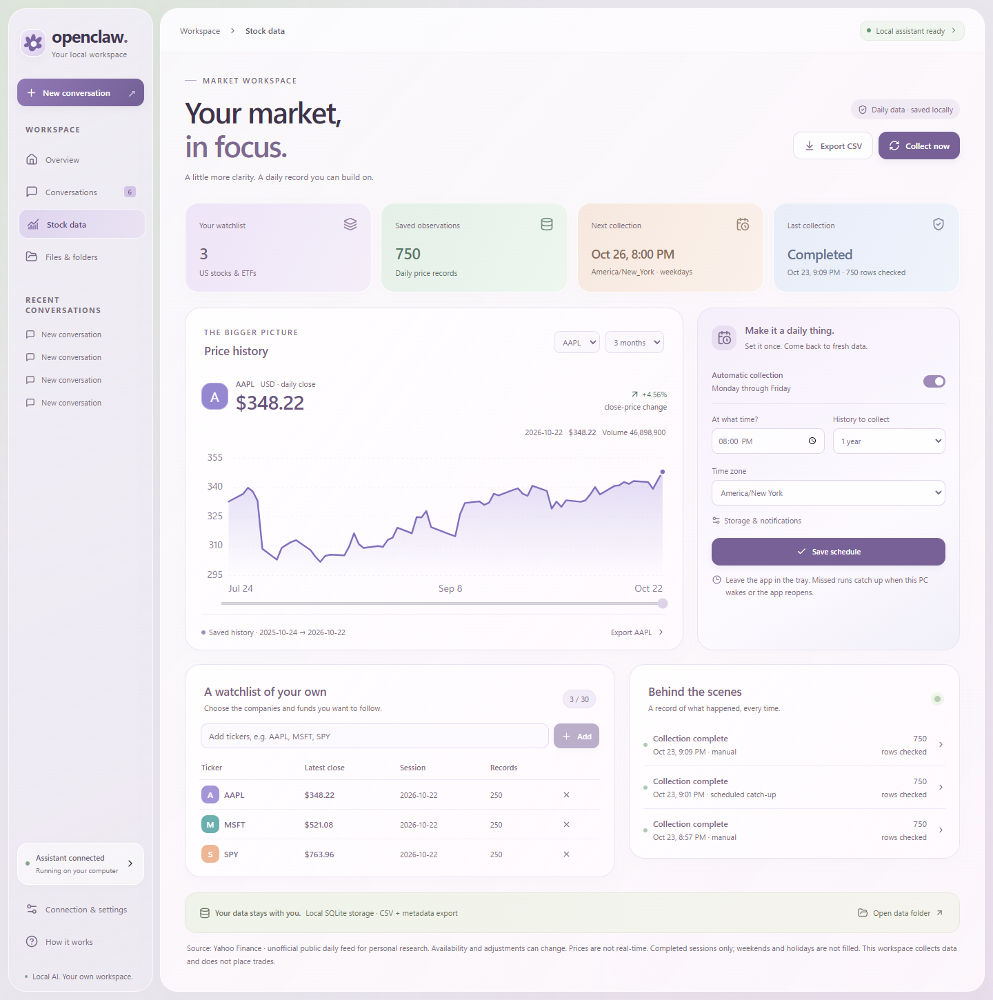
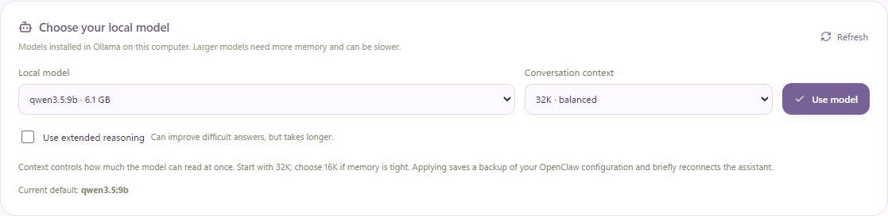

# OpenClaw Desktop

**Your local assistant, files, and scheduled market data in one Windows workspace.**

Collect daily stock and ETF history on a schedule, inspect price charts, and
export your dataset. Chat with your local model, bring files into a conversation,
and manage your OpenClaw connection without working in a terminal every day. The app connects
Ollama and an existing OpenClaw installation in WSL Ubuntu through a guided,
plain-language desktop interface.




## Start here

1. **Leave Ollama running.** You do not need to select the OpenClaw tile inside
   Ollama or start a chat there.
2. **Open Connection & settings in this app.** Check the model and OpenClaw status,
   then choose **Connect assistant** if needed.
3. **Collect stock data.** Open **Stock data**, add US ticker symbols, then choose
   **Collect now**. Set a weekday collection time and enable **Automatic collection**,
   then **Save schedule**. Use **Export CSV** to save the dataset and metadata.
4. **Start a conversation or choose a file.** Use **Conversations** for questions
   and **Files & folders** to attach documents or configure folder guidance.


## What works today

- An editable US stock/ETF watchlist, daily OHLCV and adjusted-close history,
  interactive price charts, local SQLite storage, and CSV + metadata exports.
- Timezone-aware weekday scheduling in the tray, catch-up after wake/reopening,
  bounded retries, progress, stop controls, run history, and inspectable errors.
- An overview with clear starting points for file questions and research requests.
- Local assistant conversations, saved history, inline renaming, and Markdown/PDF
  export. Failed sends keep the draft so you can retry.
- File attachments and configurable Windows folder guidance, translated to WSL
  paths. File and web capabilities depend on your OpenClaw tools and model.
- A connection page that explains the desktop, Ollama, and OpenClaw separately,
  with labeled status, recovery actions, and advanced diagnostics.
- Installed local-model selection, with context and reasoning controls, plus
  model switching inside a conversation. Model changes back up the OpenClaw
  configuration and reconnect the assistant.
- Tray behavior: closing the window keeps the app available; use the tray menu
  to exit completely.

**Still in development:** a dedicated whole-PC search interface and richer
research/task previews. Trading execution is outside this release. See the
[product plan](docs/PRODUCT_PLAN.md) for scope and priorities.


These are screenshots of the running app using real collected market data and a
local-model connection. The chat/file assistant assumes OpenClaw and Ollama are
already installed. The stock collector works independently of those services.

## Your stock-data workflow

Add up to 30 US ticker symbols (for example `AAPL`, `MSFT`, `SPY`, or `BRK-B`;
examples are not recommendations). Choose 90 days, one year, or two years of
requested daily history. **Collect now** saves validated completed sessions.
Click a ticker to inspect its chart and use the chart range/price inspection
controls. Exports contain all saved history for the current watchlist, or the
selected ticker via **Export [ticker]**, plus a metadata sidecar.

Automatic collection is opt-in, with a default of **20:00 America/New_York on
weekdays**. Keep the app in the tray. After sleep or reopening it reconciles
the most recent missed slot by refreshing the requested history window. A PC
that is powered off collects when it runs again. Previously stored prices are
retained on request failures; refreshes update revisions rather than duplicate
rows. Run details show errors and data-quality warnings.

**Source:** Yahoo Finance's unofficial public daily chart endpoint, without an
account or API key, for personal research. Availability and historical adjustments
can change. This is not a guaranteed official or real-time feed. The app excludes
in-progress sessions, keeps adjusted close separate, flags long gaps/stale dates,
and never fills missing prices. See [stock data details](docs/STOCK_DATA.md) for
storage, adjustment policies, retries, retention, export fields, and limitations.

## Prerequisites

- Windows 10/11
- Internet access for stock collection; this feature needs no model, WSL, or account.

For the local chat/file assistant, also install:

- WSL2 with Ubuntu
- OpenClaw installed inside Ubuntu
- A working Gateway config at `~/.openclaw/openclaw.json`
- Ollama running with the model configured in OpenClaw

## Open the installed desktop app

Use **OpenClaw Desktop** from the desktop shortcut or Windows Start menu. The
installed executable is normally at
`%LOCALAPPDATA%\Programs\OpenClaw Desktop\OpenClaw Desktop.exe`.
**Help → Version** identifies the build; the redesigned installer is version
**0.3.0**. Enable **Launch on startup** in Connection & settings if you want it
to open when you sign in to Windows.

Running the repository through Electron does not replace an installed copy.
After building a new installer with `npm run dist`, run that installer to update
the installed app and its shortcuts. Pushing source changes to a branch does
not update Windows installations automatically. Installed builds register their
own executable for startup; development launches do not overwrite that entry.

### What to do in Ollama

Leave Ollama running, then work in **OpenClaw Desktop**. Select your model in
this app's Connection & settings page or conversation model picker.

Ollama's **Apps** screen offers integrations with separate tools. The tiles are
not model choices, and none needs to be launched for this desktop setup:

- **OpenClaw, Hermes Agent, Hermes Desktop:** assistant integrations.
- **Claude Code, Codex CLI, OpenCode, Droid, Pi, Cline, Copilot CLI, Oh My Pi,
  DeepSeek Harness, Qwen Code:** developer/coding tool integrations.
- **Terminal:** a command-line entry point.

The OpenClaw tile can start OpenClaw's own setup/terminal interface, which is
separate from this desktop workspace. See the official
[Ollama integrations](https://docs.ollama.com/integrations) and
[OpenClaw launch documentation](https://docs.ollama.com/integrations/openclaw).

## Choose a local model

Open **Connection & settings → Choose your local model**. Select an installed,
tool-capable Ollama model, choose a context size, then click **Use model**. This
sets the default for new conversations. In a conversation, the model picker
changes that conversation's model and also sets the default for new ones.



Start with **32K** context and extended reasoning off for responsive everyday
tasks. Use **16K** if memory is tight. **64K** and extended reasoning can help
with longer inputs or difficult questions, but require more memory or time.
The picker lists local downloads and excludes Ollama cloud-model aliases;
models without tool support are disabled. Download additional models in
Ollama, then click **Refresh**.

Qwen3.5 9B was tested with real file access and web search on an RTX 5070 Ti
with 16 GB VRAM. Larger installed models are selectable, but may run much
slower. Model inference stays local. **Ollama Web Search is an online service
and requires an Ollama sign-in**, independently of local model inference.

Each model change saves a private backup beside the WSL configuration as
`~/.openclaw/openclaw.json.desktop-model-backup-<timestamp>`. Existing search
settings, credentials, providers, and fallback settings are retained.

## Development

```powershell
npm ci
npm run generate:icons
npm run dev:electron
```

The app defaults to `ws://127.0.0.1:18789`. For loopback-bound gateways, it keeps the localhost address. A WSL IP fallback is used only when that endpoint passes a health check. Authentication errors are shown without changing the host.

## Checks

```powershell
npm run typecheck
npm run build
npm test
npm run test:ui
```

`npm test` checks gateway reconnects, conversation creation/history, local-model
configuration, stock provider validation, SQLite persistence/revisions, scheduling,
retry limits, cancellation, and interrupted-run recovery.
`npm run test:ui` builds and tests the production renderer using isolated IPC
fixtures; it does not use personal files, your OpenClaw credentials, or a live
model. The UI tests use installed Google Chrome by default. Set
`PLAYWRIGHT_CHANNEL=msedge` to use an installed Edge browser instead.

The stock watchlist, real scheduled catch-up, chart, native CSV save dialog, and
exported row uniqueness were checked against a live local app. The assistant was
also checked against a live local gateway and Ollama model.
Production builds currently emit Vite large-bundle warnings.

## Build Installer

```powershell
npm run generate:icons
npm run dist
```

The NSIS installer is written to `release/`. Icon assets are generated before
packaging, and Windows executable resources embed the custom application icon.
The build preparation step verifies the pinned official Windows tool archive and
excludes its macOS-only symlinks so normal Windows builds need no symlink privilege.
Code signing is optional; an unsigned build still embeds the custom icon.

## Gateway Protocol

The client mirrors the OpenClaw TUI path verified from the official docs and source:

- WebSocket JSON frames
- pre-connect `connect.challenge`
- `connect` request with protocol version 4, operator role, admin scope, `tool-events` capability, and signed device identity
- RPCs: `chat.send`, `chat.history`, `sessions.list`, `sessions.create`, `sessions.patch`, `sessions.reset`, `agents.list`, and `models.list`
- events: `chat`, `agent`, `btw`, and `sessions.changed`

## Windows Files From WSL

Windows paths are translated before being referenced in chat:

- `C:\Users\me\file.pdf` -> `/mnt/c/Users/me/file.pdf`
- `D:\data\x.csv` -> `/mnt/d/data/x.csv`

**Connection & settings → Folder access** adds allowed folder roots. Saving settings updates a marked section in `~/.openclaw/AGENTS.md` inside WSL so the agent knows which trees to use. This is guidance, not an access-control sandbox. The chat UI shows file-access instructions in a collapsible **Thinking** row (not inside your message bubble).

Optional **prefetch folder listings** runs `find` in WSL when your message mentions an allowed folder, so the agent can summarize even before file tools are configured.

### Enable file tools in OpenClaw (WSL)

1. Confirm the folder is visible: `ls /mnt/c/Users/<you>/path/to/project`
2. Inspect config: `cat ~/.openclaw/openclaw.json`
3. Run: `openclaw doctor`
4. Restart the gateway from OpenClaw Desktop after changing config

The Desktop app does not mount drives itself; WSL already exposes `C:\` as `/mnt/c`.

## Cold start (after reboot or shutdown)

1. Open **OpenClaw Desktop** (or start it from the system tray if you enabled **Launch on startup** in Settings).
2. The app waits for WSL, optionally runs your **Local model command**, then runs **Gateway command** (default `openclaw gateway start`) and connects when the gateway health check passes.
3. If the header still shows **disconnected**, open the tray icon → **Start Gateway**, or Connection & settings → confirm **Start OpenClaw when this app opens** is enabled → Save.
4. In WSL you can verify manually: `openclaw gateway status` and `curl -s http://127.0.0.1:18789/healthz`.

If you use a separate local inference server (for example Ollama), set **Local model command** in Settings to something like `ollama serve` so it starts before the gateway.

## Diagnostics & logs

Every boot the app writes a structured log to `%APPDATA%\OpenClaw Desktop\logs\openclaw-desktop.log`. WSL command output, gateway/model process stdout/stderr, gateway connection errors, and auto-updater events all funnel into this file (and into the in-app log viewer).

- **Help → Open log file** / **Open logs folder** — opens the file in your default editor.
- **Connection & settings → Advanced & diagnostics** — live tail of the log inside the app with filtering, plus a **Run gateway diagnostics** button that executes `openclaw doctor`, `openclaw gateway status`, a healthz curl, and dumps `~/.openclaw/openclaw.json` into the log.
- If the gateway never comes up at boot, diagnostics auto-run after the warmup timeout and after three consecutive connect errors.

## Auto-update

Installed builds auto-update from GitHub Releases (`AntonIlin17/openclawUI`). On launch the app checks for a newer release in the background, downloads it, and prompts you to restart. **Help → Check for updates** triggers a manual check.

Publishing a new release:

```powershell
# bump version in package.json, then:
$env:GH_TOKEN = "<your github token with repo scope>"
npm run release
```

`electron-builder` builds the NSIS installer and publishes it with `latest.yml`
to a new GitHub release. Without a configured certificate the installer is unsigned.
Installed clients check published releases; merging source into `master` alone
does not publish an installer or update another PC.

## Tray Behavior

Closing the window minimizes to tray. Use the tray menu to open the app, create a conversation, open history, start/stop/restart the Gateway, open Settings, or Exit fully.
