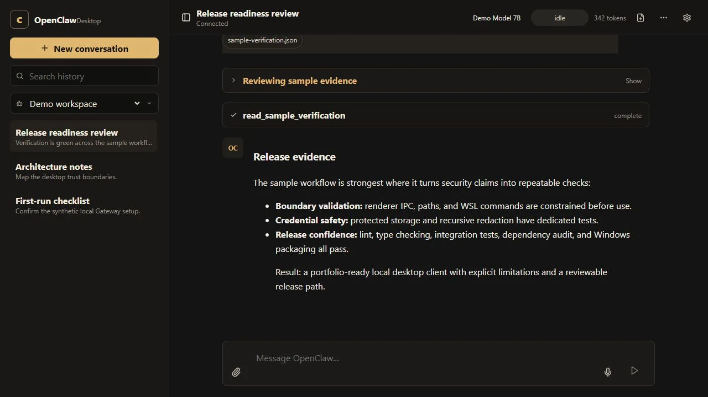

# OpenClaw Desktop

OpenClaw Desktop is a native Windows client for a local [OpenClaw](https://github.com/openclaw/openclaw) Gateway running in WSL2. It provides session history, streaming chat, tool activity, file-aware prompts, diagnostics, exports, updates, and tray controls without wrapping or scraping a terminal UI.



## Highlights

- Direct WebSocket protocol client with signed device identity, correlated requests, lifecycle state, cancellation, tick monitoring, and bounded reconnect backoff.
- Windows-to-WSL file workflows with explicit folder grants, realpath containment, safe path conversion, and system-picker attachment grants.
- Runtime-validated renderer IPC and a sandboxed Electron renderer with CSP, navigation, permission, and external-link controls.
- OS-protected settings and device credentials through Electron `safeStorage`; plaintext fallback persistence is disabled.
- Allow-listed diagnostics with recursive credential and personal-path redaction. Raw OpenClaw configuration is never copied into logs.
- First-run guidance plus deliberate connection, loading, empty, error, and recovery states.
- Lint, strict type checking, integration/unit tests, GitHub Actions, npm security audit, and a Windows unpacked-app packaging smoke test.

## Status

The public release line remains [v0.1.2](https://github.com/AntonIlin17/openclawUI/releases/tag/v0.1.2). The professionalization work is documented under `Unreleased` in [CHANGELOG.md](CHANGELOG.md); a new release requires a separate approval and is not implied by merging source changes.

## Requirements

- Windows 10 or 11
- WSL2 with an Ubuntu-compatible distribution
- OpenClaw installed inside that distribution and available on its login-shell `PATH`
- A local OpenClaw Gateway (default `ws://127.0.0.1:18789`)
- Node.js 22+ for development

The app can start the reviewed `openclaw gateway start` command. The only optional model service it can start is `ollama serve`; arbitrary renderer-provided shell commands are rejected.

## Development

```powershell
git clone https://github.com/AntonIlin17/openclawUI.git
cd openclawUI
npm ci
npm run dev:electron
```

Quality checks:

```powershell
npm run verify
npm audit
npm run package:smoke
```

`package:smoke` builds `release/win-unpacked/OpenClaw Desktop.exe` without generating or publishing an installer. See [Setup](docs/SETUP.md) for the complete workflow.

## Security model

The renderer is treated as untrusted input. Main-process IPC handlers authenticate the renderer origin and validate every argument before it can reach settings, the Gateway, the filesystem, WSL, exports, logs, or updates. WSL receives structured arguments or closed, reviewed command identifiers; user strings do not become shell programs.

Credentials are encrypted with Windows-provided `safeStorage`. If encryption is unavailable, new secrets stay in memory for the current process and are not written as plaintext. Diagnostics expose configuration presence and health booleans—not raw files or command output—and all log data passes through recursive redaction.

Read [Security architecture](docs/SECURITY.md) and [SECURITY.md](SECURITY.md) before reporting or evaluating a vulnerability.

## Windows file access

Folder access is opt-in:

1. Open **Settings → Windows file access** and select one or more roots.
2. Save to validate the roots and update the marked OpenClaw Desktop section in `~/.openclaw/AGENTS.md`.
3. Drop files only from granted roots, or select files explicitly with the system picker.

The app converts `C:\Projects\demo` to `/mnt/c/Projects/demo` without invoking a shell. Dropped paths are resolved and checked against granted roots again in the main process, including symlink/realpath containment.

## Diagnostics

**Settings → Diagnostics & logs** provides a filterable, redacted log and health checks for:

- OpenClaw configuration readability and allow-listed auth/tool summaries
- `openclaw doctor` success/failure
- `openclaw gateway status` success/failure
- Gateway health endpoint reachability
- encrypted credential storage availability

The raw `~/.openclaw/openclaw.json`, access tokens, device keys, chats, and OpenClaw user data are never included in diagnostics.

## Documentation

- [Architecture](docs/ARCHITECTURE.md)
- [Setup and development](docs/SETUP.md)
- [Troubleshooting](docs/TROUBLESHOOTING.md)
- [Security architecture](docs/SECURITY.md)
- [Known limitations](docs/LIMITATIONS.md)
- [Changelog](CHANGELOG.md)
- [Portfolio case study](showcase/case-study.md)

## Packaging and releases

`npm run dist` creates an unsigned NSIS installer under `release/`. `npm run release` can publish through `electron-builder`, but must only be used after a version decision, explicit release approval, passing CI, and review of generated artifacts. The repository keeps the historical `v0.1.1` and `v0.1.2` tags intact.

Unsigned Windows builds can trigger SmartScreen; production distribution should use an appropriate code-signing certificate. See [Known limitations](docs/LIMITATIONS.md).

## License

[MIT](LICENSE) © 2026 Anton Ilin. Dependency licenses remain their own; see [Third-party notices](THIRD_PARTY_NOTICES.md).
