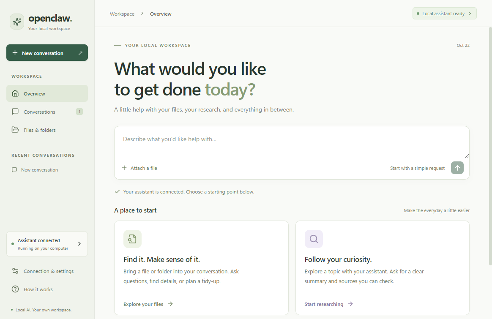
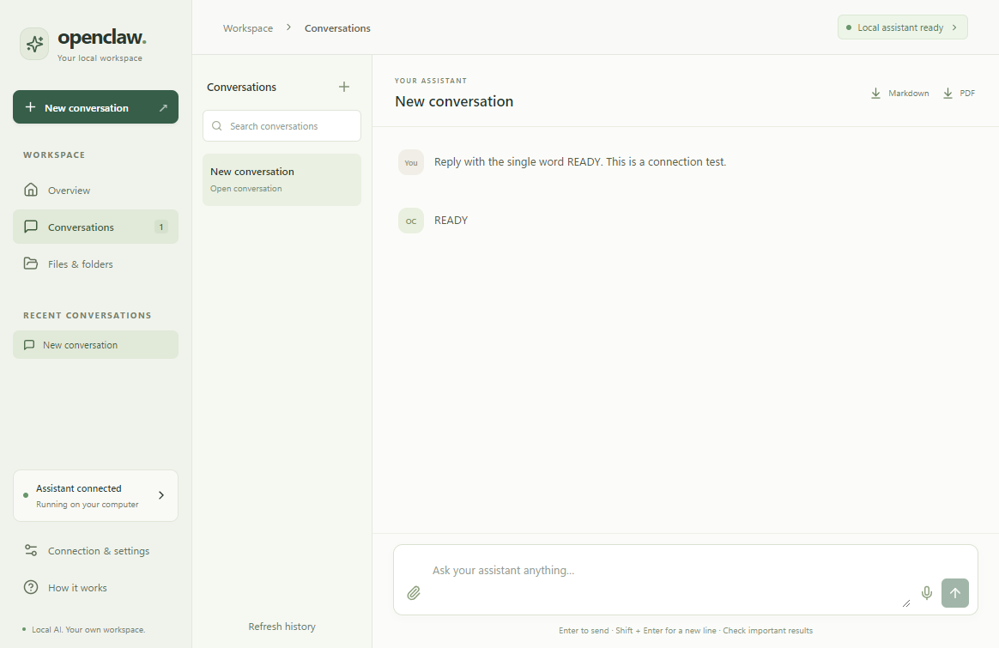
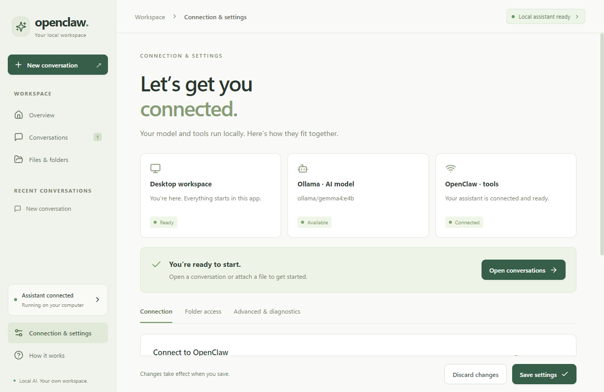

# OpenClaw Desktop

**A clearer Windows workspace for your local OpenClaw assistant.**

Chat with your local model, bring files into a conversation, and manage your
OpenClaw connection without working in a terminal every day. The app connects
Ollama and an existing OpenClaw installation in WSL Ubuntu through a guided,
plain-language desktop interface.



## Start here

1. **Leave Ollama running.** You do not need to select the OpenClaw tile inside
   Ollama or start a chat there.
2. **Open Connection & settings in this app.** Check the model and OpenClaw status,
   then choose **Connect assistant** if needed.
3. **Start a conversation or choose a file.** Use **Conversations** for questions
   and **Files & folders** to attach documents or configure folder guidance.



## What works today

- An overview with clear starting points for file questions and research requests.
- Local assistant conversations, saved history, inline renaming, and Markdown/PDF
  export. Failed sends keep the draft so you can retry.
- File attachments and configurable Windows folder guidance, translated to WSL
  paths. File and web capabilities depend on your OpenClaw tools and model.
- A connection page that explains the desktop, Ollama, and OpenClaw separately,
  with labeled status, recovery actions, and advanced diagnostics.
- Tray behavior: closing the window keeps the app available; use the tray menu
  to exit completely.

**Still in development:** scheduled US stock/ETF data collection and CSV export,
a dedicated whole-PC search interface, and richer task/result previews. The UI
labels stock collection as in development; it is not collecting data yet. See the
[product plan](docs/PRODUCT_PLAN.md) for scope and priorities.



These are screenshots of the running desktop app, including a real local-model
connection test. This is an early development build; it assumes OpenClaw and
Ollama are already installed. It does not install those dependencies for you.

## Prerequisites

- Windows 10/11
- WSL2 with Ubuntu
- OpenClaw installed inside Ubuntu
- A working Gateway config at `~/.openclaw/openclaw.json`
- Ollama running with the model configured in OpenClaw

## Development

```powershell
npm ci
npm run generate:icons
npm run dev:electron
```

The app defaults to `ws://127.0.0.1:18789`. For loopback-bound gateways, it keeps the localhost address. A WSL IP fallback is used only when that endpoint passes a health check. Authentication errors are shown without changing the host.

## Checks

```powershell
npm run typecheck
npm run build
npm test
npm run test:ui
```

`npm test` checks gateway reconnects and conversation-history normalization.
`npm run test:ui` builds and tests the production renderer using isolated IPC
fixtures; it does not use personal files, your OpenClaw credentials, or a live
model. The UI tests use installed Google Chrome by default. Set
`PLAYWRIGHT_CHANNEL=msedge` to use an installed Edge browser instead.

The redesign was also checked against a live local gateway and Ollama model.
Production builds currently emit Vite large-bundle warnings.

## Build Installer

```powershell
npm run generate:icons
npm run dist
```

The NSIS installer is written to `release/`. Code signing placeholders are present in `package.json` via `WIN_CSC_LINK` and `WIN_CSC_KEY_PASSWORD`, but signing is optional.

## Gateway Protocol

The client mirrors the OpenClaw TUI path verified from the official docs and source:

- WebSocket JSON frames
- pre-connect `connect.challenge`
- `connect` request with protocol version 4, operator role, admin scope, `tool-events` capability, and signed device identity
- RPCs: `chat.send`, `chat.history`, `sessions.list`, `sessions.create`, `sessions.patch`, `sessions.reset`, `agents.list`, and `models.list`
- events: `chat`, `agent`, `btw`, and `sessions.changed`

## Windows Files From WSL

Windows paths are translated before being referenced in chat:

- `C:\Users\me\file.pdf` -> `/mnt/c/Users/me/file.pdf`
- `D:\data\x.csv` -> `/mnt/d/data/x.csv`

**Connection & settings → Folder access** adds allowed folder roots. Saving settings updates a marked section in `~/.openclaw/AGENTS.md` inside WSL so the agent knows which trees to use. This is guidance, not an access-control sandbox. The chat UI shows file-access instructions in a collapsible **Thinking** row (not inside your message bubble).

Optional **prefetch folder listings** runs `find` in WSL when your message mentions an allowed folder, so the agent can summarize even before file tools are configured.

### Enable file tools in OpenClaw (WSL)

1. Confirm the folder is visible: `ls /mnt/c/Users/<you>/path/to/project`
2. Inspect config: `cat ~/.openclaw/openclaw.json`
3. Run: `openclaw doctor`
4. Restart the gateway from OpenClaw Desktop after changing config

The Desktop app does not mount drives itself; WSL already exposes `C:\` as `/mnt/c`.

## Cold start (after reboot or shutdown)

1. Open **OpenClaw Desktop** (or start it from the system tray if you enabled **Launch on startup** in Settings).
2. The app waits for WSL, optionally runs your **Local model command**, then runs **Gateway command** (default `openclaw gateway start`) and connects when the gateway health check passes.
3. If the header still shows **disconnected**, open the tray icon → **Start Gateway**, or Connection & settings → confirm **Start OpenClaw when this app opens** is enabled → Save.
4. In WSL you can verify manually: `openclaw gateway status` and `curl -s http://127.0.0.1:18789/healthz`.

If you use a separate local inference server (for example Ollama), set **Local model command** in Settings to something like `ollama serve` so it starts before the gateway.

## Diagnostics & logs

Every boot the app writes a structured log to `%APPDATA%\OpenClaw Desktop\logs\openclaw-desktop.log`. WSL command output, gateway/model process stdout/stderr, gateway connection errors, and auto-updater events all funnel into this file (and into the in-app log viewer).

- **Help → Open log file** / **Open logs folder** — opens the file in your default editor.
- **Connection & settings → Advanced & diagnostics** — live tail of the log inside the app with filtering, plus a **Run gateway diagnostics** button that executes `openclaw doctor`, `openclaw gateway status`, a healthz curl, and dumps `~/.openclaw/openclaw.json` into the log.
- If the gateway never comes up at boot, diagnostics auto-run after the warmup timeout and after three consecutive connect errors.

## Auto-update

Installed builds auto-update from GitHub Releases (`AntonIlin17/openclawUI`). On launch the app checks for a newer release in the background, downloads it, and prompts you to restart. **Help → Check for updates** triggers a manual check.

Publishing a new release:

```powershell
# bump version in package.json, then:
$env:GH_TOKEN = "<your github token with repo scope>"
npm run release
```

`electron-builder` will build the NSIS installer, sign nothing (signing is disabled), and publish the installer + `latest.yml` to a new GitHub release. Installed clients pick it up on next launch — no manual uninstall/reinstall needed.

## Tray Behavior

Closing the window minimizes to tray. Use the tray menu to open the app, create a conversation, open history, start/stop/restart the Gateway, open Settings, or Exit fully.
