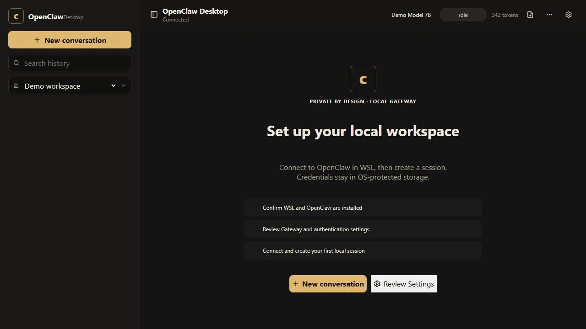

# OpenClaw Desktop showcase

This folder presents the security and product-quality work completed for OpenClaw Desktop. The images are captures of the real renderer running with a development-only synthetic data adapter; no personal gateway, account, session, chat, filesystem, model, or diagnostic data is included.

## Highlights

- Local-first Electron interface for an OpenClaw gateway running in WSL.
- Runtime-validated IPC with sender checks, safe path containment, and closed command allowlists.
- Encrypted settings and device-token storage through Electron `safeStorage` when available.
- Allow-listed diagnostics with recursive secret and personal-path redaction.
- Resilient connection lifecycle, request correlation, and bounded reconnect backoff.
- First-run, loading, empty, disconnected, and recovery experiences.
- Automated lint, type checking, tests, CI, and Windows packaging smoke coverage.

See the [case study](case-study.md), [structured project record](project.json), and [media manifest](media-manifest.md) for more detail.

## Media

| View | Purpose |
| --- | --- |
| [Connection recovery](media/connection.webp) | Clear disconnected state and guided recovery actions. |
| [Session workspace](media/session.webp) | A representative synthetic chat and release-review session. |
| [Protected settings](media/settings.webp) | Write-only token handling and conservative command choices. |
| [Safe diagnostics](media/safe-diagnostics.webp) | Allow-listed status summaries without raw configuration. |
| [Short demo](media/demo.webm) | Ten-second tour of the five synthetic product states. |

Repository: [AntonIlin17/openclawUI](https://github.com/AntonIlin17/openclawUI)

Approved public release: [v0.1.2](https://github.com/AntonIlin17/openclawUI/releases/tag/v0.1.2)
